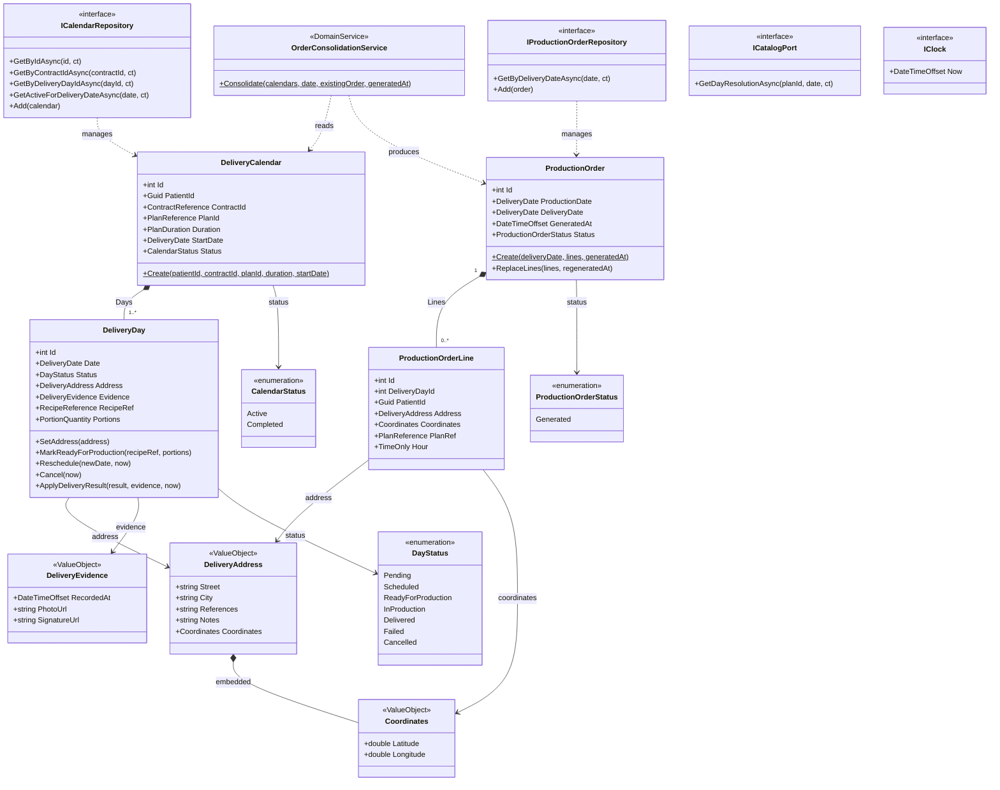
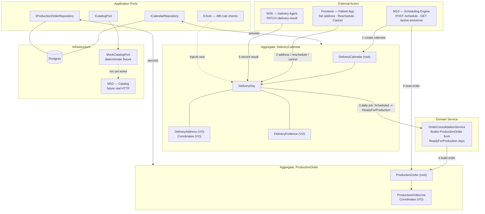

# MS4 — Delivery Calendar

Backend microservice for delivery scheduling: creates patient delivery calendars, tracks per-day
status through address assignment, catalog resolution, production, and delivery result. Pure
backend — no frontend, no auth in this stage. Built with .NET Aspire + Clean Architecture, Postgres
via EF Core.

See [`CLAUDE.md`](./CLAUDE.md) for the full domain spec and implementation roadmap.
See [`FLOWS.md`](./FLOWS.md) for every use case, its expected behavior, error scenarios, and edge
cases (48h rule, idempotency, state transitions).

## Stack

- .NET 10 / ASP.NET Core Minimal APIs
- .NET Aspire (orchestration: Postgres container, service discovery, dashboard)
- EF Core 10 + Npgsql (Postgres)
- MediatR (CQRS: Commands/Queries + Handlers)
- FluentValidation (input validation, wired into the MediatR pipeline)
- NUnit + Shouldly (tests)

## Project layout

```
src/
  Domain/          pure C# — aggregates, entities, value objects, domain services. No EF, no ASP.NET.
  Application/      MediatR commands/queries/handlers, ports (repository/clock/catalog interfaces), DTOs
  Infrastructure/   EF Core DbContext, entity configurations, repository implementations, mocked catalog adapter
  Api/              Minimal API endpoints, exception -> ProblemDetails mapping
  AppHost/           Aspire orchestration entry point (Postgres + Api)
  ServiceDefaults/   Aspire service defaults (health checks, telemetry, resilience)
  Shared/            cross-cutting constants (service/database names)
tests/
  Domain.UnitTests/            domain rules (48h boundary, state transitions, calendar generation)
  Application.UnitTests/       handlers against in-memory fakes
  Infrastructure.IntegrationTests/  repositories against real Postgres (via Aspire testing)
  Application.FunctionalTests/  end-to-end acceptance tests (MediatR pipeline) against real Postgres
  TestAppHost/                  minimal Aspire host used by the two test projects above
```

## Class diagram



## Domain architecture



## Run

```bash
dotnet run --project src/AppHost
```

Opens the Aspire dashboard, starts a Postgres container, applies EF Core migrations, and starts the
API. Find the API's Scalar reference (OpenAPI UI) from the dashboard's URL list for the `webapi`
resource, or use `src/Api/Api.http` directly (VS Code REST Client / Visual Studio / Rider all run
`.http` files).

## Test

```bash
dotnet test                                    # everything
dotnet test tests/Domain.UnitTests             # fast, no external deps
dotnet test tests/Application.UnitTests        # fast, no external deps
dotnet test tests/Infrastructure.IntegrationTests  # spins up real Postgres via Aspire — slower, needs Docker
dotnet test tests/Application.FunctionalTests      # acceptance tests, real Postgres via Aspire, needs Docker
./scripts/coverage.ps1                         # unit tests + HTML coverage report in coverage-report/
./scripts/run-newman.ps1                       # Postman flows (happy + error) headless against docker compose
./scripts/run-pact.ps1                         # Pact: consumer tests write pacts/, MS4 verifies the MS3 pact
```

More detail: [unit testing & coverage](docs/testing/UNIT-TESTING.md) · [integration testing](docs/testing/INTEGRATION-TESTING.md) · [contract testing](docs/testing/CONTRACT-TESTING.md) · [AI test-writer environment](docs/testing/AI-TEST-ENV.md).

## Database migrations

EF Core tooling needs to match the `Microsoft.EntityFrameworkCore.Design` package version in
`Directory.Packages.props` — if `dotnet ef` fails with an MSBuild target error, run
`dotnet tool update -g dotnet-ef`.

```bash
# add a migration
dotnet ef migrations add <Name> --project src/Infrastructure --startup-project src/Api --output-dir Data/Migrations

# migrations apply automatically on `dotnet run --project src/AppHost` in Development
# (ApplicationDbContextInitialiser calls Database.MigrateAsync() on startup)
```

## API

All 7 contract endpoints from `CLAUDE.md` §0, plus one internal/ops endpoint, under `/api/v1`:

| Endpoint | Method | Caller |
|---|---|---|
| `/schedule` | POST | MS3 — create calendar (idempotent by `contractId`) |
| `/calendars/active-tomorrow` | GET | MS3 — consolidated production order for a date |
| `/calendars/{id}/dates` | PUT | Frontend — reschedule a day (rejected <48h out) |
| `/calendars/{id}/addresses` | POST | Frontend — set delivery address for a day |
| `/calendars/{id}/cancel-day` | POST | Frontend — cancel a day (rejected <48h out) |
| `/calendars/{id}` | GET | Frontend/internal — full calendar with all days |
| `/calendars/days/{dayId}/delivery-result` | PATCH | MS5 — report delivered/failed (idempotent) |
| `/calendars/resolve-daily-catalog` | POST | internal/ops — manually trigger the daily catalog resolution job (must run before MS3 calls `active-tomorrow` for that date) |

Error mapping: `400` validation, `404` not found, `409` 48h lock window violation, `422` invalid
state transition. See `FLOWS.md` for exact scenarios per endpoint.

## Scalar walkthrough — testing the flow end-to-end

Open Scalar at the URL shown in the Aspire dashboard for the `webapi` resource (path: `/scalar/v1`).
All endpoints are listed under the **Calendars** tag and numbered `[Step 1]`–`[Step 8]` to guide test order.

Today's date in the examples below: `2026-07-11` — adjust dates to match your run.

---

### Step 1 — Create a delivery calendar

`POST /api/v1/schedule`

```json
{
  "contractId": "11111111-0000-0000-0000-000000000001",
  "patientId":  "22222222-0000-0000-0000-000000000001",
  "planId":     "33333333-0000-0000-0000-000000000001",
  "duration":   15,
  "startDate":  "2026-07-12"
}
```

Returns `calendarId` (integer) + 15 days, all `Pending`. **Copy `calendarId` and one `dayId`** — every later step needs them.

| Scenario | What to do | Expected |
|----------|-----------|----------|
| Happy path | Send the request above | 200 — `calendarId` + day list |
| Idempotent retry | Send again with the **same `contractId`** | 200 — same calendar returned, no duplicate created |
| Invalid duration | Change `"duration"` to `7` | 400 — `FluentValidation` error |

---

### Step 2 — Inspect the calendar

`GET /api/v1/calendars/{id}` — use `calendarId` from Step 1.

Returns the full calendar with all days and their current `Pending` status. Find the day whose `date` is `2026-07-12` (tomorrow) — **note its `dayId`** for Steps 3–4.

| Scenario | What to do | Expected |
|----------|-----------|----------|
| Happy path | Use `calendarId` from Step 1 | 200 — all days `Pending` |
| Not found | Use a non-existent ID (e.g. `9999`) | 404 |

---

### Step 3 — Set a delivery address for a day

`POST /api/v1/calendars/{calendarId}/addresses`

Use the `dayId` for tomorrow's day from Step 2 so that Step 4 can resolve it.

```json
{
  "dayId":     <dayId from Step 2 — the one dated 2026-07-12>,
  "street":    "Av. Javier Prado 123",
  "city":      "Lima",
  "latitude":  -12.0833,
  "longitude": -77.0167
}
```

Day status moves `Pending → Scheduled`. Returns `dayId` + address.

| Scenario | What to do | Expected |
|----------|-----------|----------|
| Happy path | Payload above | 200 — day is now `Scheduled` |
| Update address | Call again with a different street | 200 — address overwritten, still `Scheduled` |
| Invalid coordinates | Set `latitude` to `200` | 400 — validation error |
| Wrong state | Use a `dayId` that is already `Delivered` or `Cancelled` (see seed Patient 3) | 422 |

---

### Step 4 — Run daily catalog resolution (ops trigger)

`POST /api/v1/calendars/resolve-daily-catalog` — no body required.

Finds all `Scheduled` days dated tomorrow, calls `ICatalogPort` (mocked — deterministic fixture), sets `RecipeRef`/`Portions`, moves each day to `ReadyForProduction`, and rebuilds the `ProductionOrder` for that date.

Add `?date=2026-07-12` as a query param to target a specific date (default is tomorrow).

Returns **204 No Content**.

| Scenario | What to do | Expected |
|----------|-----------|----------|
| Happy path | Call with no params | 204 — tomorrow's Scheduled days → ReadyForProduction |
| Re-run | Call again for the same date | 204 — idempotent, existing order's lines replaced, no duplicate |
| Specific date | Add `?date=2026-07-15` | 204 — resolves that date instead of tomorrow |

---

### Step 5 — Get tomorrow's production order

`GET /api/v1/calendars/active-tomorrow`

Returns all `ReadyForProduction` days for tomorrow, mapped to `{ packId, patientId, planId, hour, address, lat, long }`. Step 4 must have run first or this returns an empty list.

Add `?date=2026-07-12` to query a specific date.

| Scenario | What to do | Expected |
|----------|-----------|----------|
| After Steps 1–4 | Call with no params | 200 — the day from Step 3 appears |
| Before Step 4 (fresh run with seed data) | Skip Steps 1–4, call immediately | 200 — seed Patient 2 has a pre-resolved day for tomorrow |
| No resolved days | Target a date that had no `Scheduled` days | 200 — empty list (not 404) |

---

### Step 6 — Reschedule a delivery day

`PUT /api/v1/calendars/{calendarId}/dates`

```json
{
  "dayId":   <dayId of a Pending or Scheduled day with date > 48h from now>,
  "newDate": "2026-08-01"
}
```

Returns `dayId` + `status` (unchanged — rescheduling doesn't change status).

| Scenario | What to do | Expected |
|----------|-----------|----------|
| Happy path | Use a day dated far in the future | 200 |
| 48h lock | Use a day whose **current** date is `2026-07-12` (less than 48h away) | 409 |
| Wrong state | Use a day in `ReadyForProduction` or `Delivered` | 422 |

---

### Step 7 — Cancel a delivery day

`POST /api/v1/calendars/{calendarId}/cancel-day`

```json
{
  "dayId": <dayId of a Pending or Scheduled day with date > 48h from now>
}
```

Day moves to `Cancelled` (terminal — cannot be undone).

| Scenario | What to do | Expected |
|----------|-----------|----------|
| Happy path | Day dated far in the future | 200 — `Cancelled` |
| 48h lock | Day dated tomorrow (`2026-07-12`) | 409 |
| Already cancelled | Call twice on the same day | 422 on second call |
| Terminal state | Use a `Delivered` or `Failed` day | 422 |

---

### Step 8 — Record delivery result (MS5 callback)

`PATCH /api/v1/calendars/days/{dayId}/delivery-result`

Day must be `ReadyForProduction` or `InProduction`. Use the `dayId` that went through Steps 3–4, or grab the pre-resolved day from seed Patient 2.

```json
{
  "result":       "DELIVERED",
  "photoUrl":     "https://example.com/evidence.jpg",
  "signatureUrl": null
}
```

Returns `dayId` + final `status` (`Delivered` or `Failed`).

| Scenario | What to do | Expected |
|----------|-----------|----------|
| Delivered | `"result": "DELIVERED"` | 200 — day is `Delivered` |
| Failed | `"result": "FAILED"` | 200 — day is `Failed` |
| Idempotent retry | Call twice with the **same** `result` | 200 both times — no error |
| Conflicting retry | Call with `DELIVERED`, then call again with `FAILED` | 200 then **422** |
| Wrong state | Use a `Pending` or `Cancelled` day | 422 |

---

## Business rules

### 48-hour lock window
A delivery day is **locked** once its scheduled date is less than 48 hours away. Any attempt to reschedule or cancel a locked day is rejected with a `409 Conflict`. The boundary is inclusive: exactly 48 hours remaining is not locked.

### Calendar creation
- A calendar always spans exactly **15 or 30 days** starting from `startDate`, one delivery day per day.
- The `POST /schedule` endpoint is **idempotent by `contractId`**: calling it a second time with the same contract returns the existing calendar without creating a duplicate.

### Delivery day statuses
A day progresses through a strict one-way pipeline:

```
Pending → Scheduled → ReadyForProduction → Delivered
                                         → Failed
       ↘ (any stage before terminal) → Cancelled
```

| Status | Meaning |
|---|---|
| `Pending` | Day created, no address yet |
| `Scheduled` | Address set — day is queued for catalog resolution |
| `ReadyForProduction` | Recipe and portions resolved via MS2 catalog — day is in the production order |
| `Delivered` | MS5 confirmed delivery with evidence |
| `Failed` | MS5 reported a failed delivery attempt |
| `Cancelled` | Patient or operator cancelled the delivery — **terminal, cannot be undone** |

### Allowed operations per status

| Operation | Allowed statuses | Locked <48h? |
|---|---|---|
| Set address | `Pending`, `Scheduled` | No lock (no time restriction) |
| Reschedule date | `Pending`, `Scheduled` | Yes — rejected if <48h out |
| Cancel | `Pending`, `Scheduled`, `ReadyForProduction` | Yes — rejected if <48h out |
| Record delivery result | `ReadyForProduction`, `InProduction` | No lock |

### Delivery results
- Only **MS5** can move a day to `Delivered` or `Failed` — this cannot be done manually through any other endpoint.
- Reporting the same result twice (e.g. `DELIVERED` → `DELIVERED`) is a **no-op** — the call succeeds and returns the current status unchanged.
- Reporting a conflicting result (e.g. `DELIVERED` then `FAILED`) is rejected with `422`.

### Catalog resolution
The daily catalog job (`POST /calendars/resolve-daily-catalog`) must run **before** MS3 calls `GET /calendars/active-tomorrow` for a given date. Only days in `Scheduled` status receive recipe/portion data from MS2 and move to `ReadyForProduction`. Days without an address (`Pending`) are skipped silently. The job is idempotent — running it twice for the same date replaces the production order lines without creating duplicates.

---

## Service dependencies and inter-microservice communication

### Who calls MS4

| Caller | Endpoint | When |
|---|---|---|
| **MS3** (contracting) | `POST /api/v1/schedule` | After patient payment is confirmed — creates the delivery calendar |
| **MS3** (contracting) | `GET /api/v1/calendars/active-tomorrow` | Daily — retrieves all addresses and plan IDs for next-day production planning |
| **Frontend** (patient app) | `PUT /api/v1/calendars/{id}/dates` | Patient reschedules a delivery day |
| **Frontend** (patient app) | `POST /api/v1/calendars/{id}/addresses` | Patient sets or updates a delivery address |
| **Frontend** (patient app) | `POST /api/v1/calendars/{id}/cancel-day` | Patient cancels a delivery day |
| **Frontend** (patient app) | `GET /api/v1/calendars/{id}` | Patient views their full calendar |
| **MS5** (delivery) | `PATCH /api/v1/calendars/days/{dayId}/delivery-result` | Courier records delivery outcome with evidence |

### What MS4 calls outbound

| Dependency | Endpoint | Purpose | Current state |
|---|---|---|---|
| **MS2** (catalog) | `GET /catalog/plans/{id}/day/{date}` | Fetch recipe reference and portion count for a plan on a given date | **Mocked** — `MockCatalogPort` returns a deterministic fixture; no real HTTP call yet |

### Known integration gaps (pending resolution upstream)

1. **MS5 does not yet call MS4.** The master architecture table has no row showing MS5 calling `PATCH /delivery-result`. Until MS5 is wired to call this endpoint, every delivery day stays stuck in `ReadyForProduction` permanently and delivery outcomes are never recorded. This is a gap in MS5's implementation, not in MS4.

2. **MS4 ↔ MS2 contract needs reconciliation before going live.** Three conflicting shapes exist:
   - This service expects `GET /catalog/plans/{id}/day/{date}` (day-specific, returns recipe + portions).
   - The master table describes a plain `GET /catalog/plans/{id}` (existence check only, no recipe data).
   - MS3 uses a separate batch endpoint `POST /catalog/plans/structure` for recipe resolution.
   The correct shape must be agreed with the MS2 team before replacing `MockCatalogPort` with a real HTTP adapter, or the daily catalog job will call a path that MS2 doesn't expose.

3. **`GET /calendars/{id}` is absent from the master table.** All other frontend-read endpoints appear in it. Low risk since it has no cross-service dependency, but the master table should be updated for completeness.

See `CLAUDE.md` §5 "Cross-service integration gaps" for the full audit details.

---

## Notes for local dev

- `ICatalogPort` (outbound call to MS2) is mocked — `MockCatalogPort` returns deterministic fixture
  data, no real network call.
- Seed data loads automatically on first run against an empty database (`dotnet run --project
  src/AppHost`, Development environment only): 3 patients with fixed GUIDs
  (`aaaaaaaa-0000-0000-0000-000000000001/2/3`) covering `Pending`, `Scheduled`,
  `ReadyForProduction`, `Delivered`, `Failed`, and `Cancelled` days. Patient 2's calendar has
  tomorrow's day pre-consolidated into a `ProductionOrder`, so `GET
  /calendars/active-tomorrow` returns data without running the catalog job first. Seeding is
  skipped if the database already has any calendar.
- No auth in this stage (confirmed decision, see `CLAUDE.md` §3.4).

---

## Presentación del microservicio (español)

> Texto pensado para ser leído en voz alta al presentar el proyecto. Sigue el orden lógico del sistema: contexto → dominio → flujo → reglas → endpoints → arquitectura → pruebas → pendientes.

---

### Contexto general

Este proyecto forma parte de un sistema más grande compuesto por cinco microservicios —MS1 al MS5— que en conjunto gestionan el ciclo completo de atención a pacientes que reciben alimentación a domicilio: desde el registro del paciente y la selección del plan nutricional, pasando por la contratación y el pago, hasta la producción diaria de los alimentos y la entrega en el domicilio del paciente.

Dentro de ese sistema, **MS4 es el Microservicio de Calendario de Entregas**. Su única responsabilidad es crear, gestionar y hacer seguimiento de los calendarios de entrega de cada paciente: saber qué días hay que entregar, a qué dirección, qué receta corresponde, y qué pasó con cada entrega una vez que el repartidor la realizó.

---

### ¿Qué problema resuelve?

Cuando un paciente contrata un plan nutricional a través de MS3, lo que en realidad está comprando es una secuencia de entregas diarias: 15 o 30 días de alimentación, uno por día. MS4 es quien materializa esa promesa como un calendario concreto con fechas, estados y direcciones. Sin MS4, nadie sabe cuándo hay que entregar, dónde hay que ir ni si esa entrega ya ocurrió o falló.

---

### El modelo de dominio

El núcleo del sistema gira en torno a dos conceptos principales:

**El Calendario de Entregas** (`DeliveryCalendar`) es el objeto raíz. Pertenece a un paciente, está asociado a un contrato y a un plan nutricional de MS2, tiene una duración de 15 o 30 días, y contiene una lista de días de entrega.

**El Día de Entrega** (`DeliveryDay`) representa una entrega individual. Cada día tiene una fecha, un estado, y puede tener una dirección, una receta asignada, y evidencia de entrega. El día es la unidad mínima sobre la que se operan las acciones del paciente y del repartidor.

Existe también una **Orden de Producción** (`ProductionOrder`), que es una instantánea consolidada de todos los días listos para el día siguiente. Es lo que MS3 consulta para saber qué hay que cocinar y preparar.

---

### El ciclo de vida de un día de entrega

Un día de entrega pasa por los siguientes estados, en orden:

1. **Pending** — el día fue creado pero el paciente aún no ha puesto una dirección de entrega.
2. **Scheduled** — el paciente registró su dirección. El día ya tiene destino.
3. **ReadyForProduction** — un proceso diario consultó el catálogo de MS2 y asignó la receta y las porciones correspondientes. El día está incluido en la orden de producción.
4. **Delivered** o **Failed** — el repartidor (a través de MS5) confirmó el resultado de la entrega, con o sin evidencia fotográfica.
5. **Cancelled** — en cualquier momento antes de que la entrega ocurra, el paciente o el operador puede cancelar el día. Una vez cancelado, no hay vuelta atrás.

Este flujo es unidireccional y estricto: el sistema rechaza cualquier operación que intente saltarse un paso o revertir un estado terminal.

---

### Las reglas de negocio más importantes

**Regla de las 48 horas:** un día de entrega queda "bloqueado" en cuanto faltan menos de 48 horas para su fecha. A partir de ese momento, no se puede reprogramar ni cancelar. Si alguien intenta hacerlo, el sistema responde con un error 409. Esta regla existe para proteger la cadena de producción: una vez que el equipo de cocina ya comenzó a preparar los alimentos para el día siguiente, no es posible cambiar la dirección o cancelar sin afectar la operación.

**Idempotencia en la creación:** si MS3 llama dos veces a crear un calendario para el mismo contrato —por ejemplo por un reintento de red— el sistema devuelve el calendario ya existente sin crear uno duplicado. Esto protege la integridad de los datos ante fallos de comunicación entre servicios.

**Solo MS5 puede cerrar el ciclo:** un día de entrega únicamente puede pasar a estado Entregado o Fallido a través del endpoint que MS5 llama cuando el repartidor registra el resultado. Ningún otro actor puede forzar ese cambio manualmente. Esto garantiza que el estado del sistema siempre refleja lo que realmente ocurrió en campo.

**Idempotencia en el resultado:** si MS5 reporta el mismo resultado dos veces para el mismo día —cosa que puede pasar por reintentos— la segunda llamada es un no-operación: el sistema acepta la solicitud, devuelve el estado actual y no produce ningún error ni cambio de estado. Si en cambio MS5 intenta reportar un resultado contradictorio (por ejemplo, primero "entregado" y luego "fallido"), el sistema lo rechaza con un 422.

---

### Los siete endpoints

El microservicio expone exactamente siete endpoints públicos, más uno interno para operaciones. Cada endpoint tiene un propósito único y un único actor que lo llama — no hay endpoints genéricos ni multipropósito.

---

#### Endpoint 1 — Crear el calendario
`POST /api/v1/schedule` · Caller: **MS3**

Es el punto de entrada de todo el sistema. MS3 lo llama inmediatamente después de confirmar el pago del paciente.

**Recibe:**
```json
{
  "contractId": "uuid del contrato",
  "patientId":  "uuid del paciente",
  "planId":     "uuid del plan nutricional en MS2",
  "duration":   15,
  "startDate":  "2026-08-01"
}
```

**Devuelve:** el `calendarId` (entero) más la lista completa de días generados, todos en estado `Pending`. Si la duración es 15, devuelve 15 días; si es 30, devuelve 30.

**Comportamiento especial — idempotencia:** si MS3 llama dos veces con el mismo `contractId` (reintento por fallo de red, por ejemplo), el sistema detecta que ya existe un calendario para ese contrato y devuelve el existente sin crear un duplicado. Mismo resultado, sin efectos secundarios.

**Errores posibles:** `400` si la duración no es 15 ni 30, o si algún ID viene vacío.

---

#### Endpoint 2 — Consultar el calendario completo
`GET /api/v1/calendars/{id}` · Caller: **Frontend del paciente**

Devuelve el estado actual del calendario con todos sus días: fecha, estado, dirección asignada (si la hay) y evidencia de entrega (si ya se registró). Es la vista principal del paciente sobre su plan de entregas.

**Devuelve:** el calendario con su lista de días, cada uno con `id`, `date`, `status`, y opcionalmente `address` y `evidence`.

**Errores posibles:** `404` si el `calendarId` no existe.

---

#### Endpoint 3 — Registrar dirección de entrega
`POST /api/v1/calendars/{id}/addresses` · Caller: **Frontend del paciente**

El paciente indica a qué dirección debe llegar la entrega de un día específico. Este es el paso que "activa" un día: sin dirección no hay entrega posible.

**Recibe:**
```json
{
  "dayId":     123,
  "street":    "Av. Javier Prado 1234",
  "city":      "Lima",
  "latitude":  -12.0833,
  "longitude": -77.0167,
  "references": "Puerta principal (opcional)",
  "notes":      "Tocar timbre dos veces (opcional)"
}
```

**Devuelve:** el `dayId` y la dirección registrada. El día pasa automáticamente de `Pending` a `Scheduled`. Si el día ya tenía dirección, se sobreescribe.

**Errores posibles:** `400` si las coordenadas están fuera de rango (latitud ±90, longitud ±180), `404` si el calendario o el día no existen, `422` si el día está en un estado que no admite cambio de dirección (por ejemplo, ya fue cancelado o entregado).

---

#### Endpoint 4 — Reprogramar un día
`PUT /api/v1/calendars/{id}/dates` · Caller: **Frontend del paciente**

Permite mover la fecha de una entrega a otro día. Útil cuando el paciente sabe que no estará en casa en la fecha original.

**Recibe:**
```json
{
  "dayId":   123,
  "newDate": "2026-08-15"
}
```

**Devuelve:** el `dayId` y el estado actual del día (que no cambia — solo cambia la fecha).

**Regla de las 48 horas:** si la fecha actual del día está a menos de 48 horas de distancia, la reprogramación es rechazada. La cocina ya empezó a preparar esa entrega y no puede revertirse. El sistema devuelve `409` con un mensaje claro.

**Errores posibles:** `404` si el día no existe, `409` si la ventana de 48 horas ya pasó, `422` si el día está en `ReadyForProduction`, `Delivered`, `Failed` o `Cancelled` (solo se pueden reprogramar días `Pending` o `Scheduled`).

---

#### Endpoint 5 — Cancelar un día
`POST /api/v1/calendars/{id}/cancel-day` · Caller: **Frontend del paciente**

El paciente decide que no quiere recibir la entrega de un día específico.

**Recibe:**
```json
{
  "dayId": 123
}
```

**Devuelve:** el `dayId` y el nuevo estado `Cancelled`.

**Cancelación terminal:** una vez cancelado, el día no puede reactivarse. No existe un endpoint de "revertir cancelación" porque hacerlo implicaría volver a negociar con MS2 y MS3, lo que está fuera del alcance de MS4.

**Regla de las 48 horas:** igual que la reprogramación — si faltan menos de 48 horas, se rechaza con `409`.

**Errores posibles:** `404` si el día no existe, `409` si la ventana de 48 horas ya cerró, `422` si el día ya estaba cancelado, entregado o fallido.

---

#### Endpoint 6 — Orden activa para mañana
`GET /api/v1/calendars/active-tomorrow` · Caller: **MS3**

Este es el endpoint de mayor impacto operativo. MS3 lo llama una vez por día (la noche anterior) para saber exactamente qué hay que producir y entregar al día siguiente.

**Devuelve:** una lista de líneas de producción, una por cada día de entrega en estado `ReadyForProduction` para la fecha objetivo:
```json
[
  {
    "packId":    123,
    "patientId": "uuid",
    "planId":    "uuid del plan",
    "hour":      "09:00",
    "address":   "Av. Javier Prado 1234, Lima",
    "lat":       -12.0833,
    "long":      -77.0167
  }
]
```

Con esa lista, MS3 sabe cuántas preparaciones hay que hacer, de qué plan es cada una, y a qué dirección enviarlas. Si un día no tiene dirección asignada (`Pending`) o no fue procesado por el job de catálogo (`Scheduled`), no aparece en esta lista.

**Parámetro opcional `?date=`:** permite consultar la orden para una fecha distinta a mañana. Útil para pruebas o para consultar días pasados.

---

#### Endpoint 7 — Registrar resultado de entrega
`PATCH /api/v1/calendars/days/{dayId}/delivery-result` · Caller: **MS5**

Es el cierre del ciclo. Cuando el repartidor termina una entrega, MS5 llama a este endpoint para dejar constancia del resultado.

**Recibe:**
```json
{
  "result":       "Delivered",
  "photoUrl":     "https://cdn.ejemplo.com/foto-entrega.jpg",
  "signatureUrl": "https://cdn.ejemplo.com/firma.png"
}
```

`result` puede ser `Delivered` (entrega exitosa) o `Failed` (intento fallido). La evidencia es opcional — una entrega puede marcarse como fallida sin foto.

**Devuelve:** el `dayId` y el nuevo estado (`Delivered` o `Failed`).

**Idempotencia:** si MS5 llama dos veces con el mismo resultado (reintento), la segunda llamada no produce ningún cambio ni error. Si MS5 intenta cambiar el resultado de `Delivered` a `Failed` (o viceversa), el sistema lo rechaza con `422` — un resultado ya registrado es inmutable.

**Errores posibles:** `404` si el `dayId` no existe, `422` si el día no está en `ReadyForProduction` o `InProduction` (no se puede entregar algo que no fue preparado).

---

#### Endpoint interno — Resolución de catálogo
`POST /api/v1/calendars/resolve-daily-catalog` · Caller: **ops / demo**

No forma parte del contrato público de MS4. Es el disparador manual del job nocturno que, para cada día en estado `Scheduled` con fecha objetivo, consulta a MS2 para obtener la receta y las porciones, mueve el día a `ReadyForProduction`, y construye la `ProductionOrder` que el endpoint 6 luego devuelve.

En producción este proceso correría automáticamente cada noche vía un scheduler. En esta etapa se expone como endpoint para poder demostrar el flujo completo sin depender de un cron job real. Acepta un parámetro `?date=` para apuntar a una fecha específica.

---

### Comunicación con otros microservicios

MS4 recibe llamadas de tres fuentes: de **MS3** para crear calendarios y consultar la orden del día siguiente, del **frontend del paciente** para gestionar direcciones, reprogramaciones y cancelaciones, y de **MS5** para registrar resultados de entrega.

En sentido saliente, MS4 depende de **MS2** (el catálogo de planes) para obtener la receta y las porciones que corresponden a cada plan nutricional en una fecha dada. En esta etapa esa dependencia está simulada mediante un adaptador de prueba (`MockCatalogPort`) que devuelve datos fijos sin hacer ninguna llamada de red real. Antes de salir a producción, ese adaptador deberá reemplazarse por uno que llame al endpoint real de MS2, y el contrato exacto de esa llamada deberá acordarse con el equipo de MS2 porque actualmente existen tres versiones distintas en la documentación del sistema.

También vale la pena mencionar una brecha pendiente: MS5 aún no está implementado para llamar al endpoint de resultado de entrega de MS4. Hasta que eso ocurra, los días quedan en estado ReadyForProduction indefinidamente y el ciclo nunca se cierra. La solución está del lado de MS5, no de MS4.

---

### Arquitectura técnica

El microservicio está construido con **.NET 10** y usa **.NET Aspire** para orquestar el contenedor de base de datos y exponer el dashboard de observabilidad. Sigue el patrón de **Clean Architecture** en cuatro capas:

- **Domain**: el corazón del sistema. Contiene los agregados, entidades, objetos de valor y servicios de dominio. No tiene dependencias externas: ni base de datos, ni HTTP, ni nada del framework. Aquí viven todas las reglas de negocio, incluyendo la regla de las 48 horas, los cambios de estado y las validaciones de los objetos de valor.

- **Application**: define los casos de uso como comandos y consultas usando el patrón CQRS a través de MediatR. También define las interfaces (puertos) que la capa de infraestructura debe implementar: el repositorio de calendarios, el repositorio de órdenes de producción, el adaptador del catálogo y el reloj del sistema.

- **Infrastructure**: implementa esos puertos usando Entity Framework Core contra PostgreSQL, incluyendo las migraciones de base de datos, los repositorios concretos y el adaptador simulado de MS2.

- **Api**: expone los endpoints como Minimal APIs de ASP.NET Core. Convierte los errores de dominio en respuestas HTTP semánticas: 400 para validación, 404 para recursos no encontrados, 409 para la regla de las 48 horas y 422 para transiciones de estado inválidas.

La base de datos es **PostgreSQL**, gestionada completamente a través de contenedores Docker por Aspire. La interfaz de exploración de la API es **Scalar** (equivalente moderno de Swagger), accesible desde el dashboard de Aspire.

---

### Pruebas

El proyecto tiene cuatro niveles de pruebas:

**Pruebas unitarias de dominio**: verifican las reglas de negocio puras —el caso exacto de frontera de las 48 horas, las transiciones de estado válidas e inválidas, la generación correcta de los días del calendario según la duración— sin ninguna dependencia externa.

**Pruebas unitarias de aplicación**: prueban cada handler de comando y consulta usando repositorios y adaptadores en memoria. Verifican que la lógica de orquestación es correcta sin tocar la base de datos.

**Pruebas de integración de infraestructura**: levantan un contenedor real de PostgreSQL a través de Aspire y verifican que los repositorios persisten y recuperan datos correctamente contra una base de datos real.

**Pruebas funcionales de aceptación**: pruebas de extremo a extremo que verifican los siete criterios de aceptación del sistema —idempotencia de creación, regla de las 48 horas para cancelación y reprogramación, consulta de días activos para mañana, idempotencia del resultado de entrega— tanto a través del pipeline de MediatR directamente como a través de HTTP real, incluyendo la verificación de códigos de estado y cuerpos de error.

En total el proyecto cuenta con más de 60 pruebas automatizadas, todas en verde.

---

### Demostración en vivo con Postman

Para mostrar el sistema funcionando en tiempo real, el proyecto incluye una colección de Postman completamente automatizada (`src/Api/MS4-Delivery-Calendar.postman_collection.json`) que ejecuta todos los flujos sin necesidad de cambiar ningún valor a mano. Los identificadores de paciente, contrato y plan se generan automáticamente al momento de ejecutar, y las fechas se calculan a partir de la fecha del día en que se corre la colección.

La colección tiene cinco flujos organizados en orden de complejidad:

**Flujo 1 — Camino feliz completo**: es el flujo principal de la demostración. En nueve pasos encadenados muestra el ciclo de vida completo de un día de entrega desde cero: se crea el calendario, se asigna una dirección, se activa el proceso de resolución de catálogo, se consulta la orden de producción resultante, se reprograma un día a una fecha futura, se cancela otro día, y finalmente se registra el resultado de la entrega. Cada respuesta alimenta automáticamente al siguiente paso: el `calendarId` que devuelve el primer request se usa en todos los demás sin que el usuario tenga que copiarlo.

**Flujo 2 — Idempotencia**: llama dos veces a `POST /schedule` con el mismo `contractId` y verifica que el sistema devuelve el mismo `calendarId` sin crear un duplicado. Demuestra que el microservicio es seguro ante reintentos de red.

**Flujo 3 — Regla de las 48 horas**: crea un calendario cuya primera entrega cae hoy mismo, y luego intenta cancelar y reprogramar ese día. Ambas operaciones deben devolver 409, demostrando que la ventana de bloqueo funciona correctamente.

**Flujo 4 — Transiciones de estado inválidas**: muestra qué pasa cuando se intenta operar sobre un día en el estado equivocado. Cancela un día, y luego intenta asignarle una dirección, cancelarlo por segunda vez, y marcarlo como entregado siendo Pendiente. Las tres operaciones devuelven 422.

**Flujo 5 — Errores de validación**: prueba los casos de error más básicos: duración inválida (7 en vez de 15 o 30) devuelve 400, un calendario inexistente devuelve 404, y coordenadas fuera de rango devuelven 400.

Para ejecutar la demostración: importar el archivo en Postman, configurar la variable `baseUrl` con la URL que muestra el dashboard de Aspire para el recurso `webapi`, y usar el **Collection Runner** para correr todos los flujos en secuencia. Cada request muestra su resultado con aserciones en verde si el comportamiento es el esperado.

---

### Estado actual y próximos pasos

El microservicio está completamente implementado y probado en todas las capas. Las siete etapas de implementación planificadas originalmente están terminadas: scaffolding, modelo de dominio, capa de aplicación, infraestructura, endpoints de API, datos de prueba y pruebas de aceptación.

Los pendientes no son defectos de MS4 sino decisiones de integración que dependen de otros equipos: la conexión real con MS2 para resolver recetas, la implementación en MS5 de la llamada al endpoint de resultado de entrega, y la alineación de la tabla maestra de endpoints del sistema para que refleje correctamente todas las interacciones existentes.
